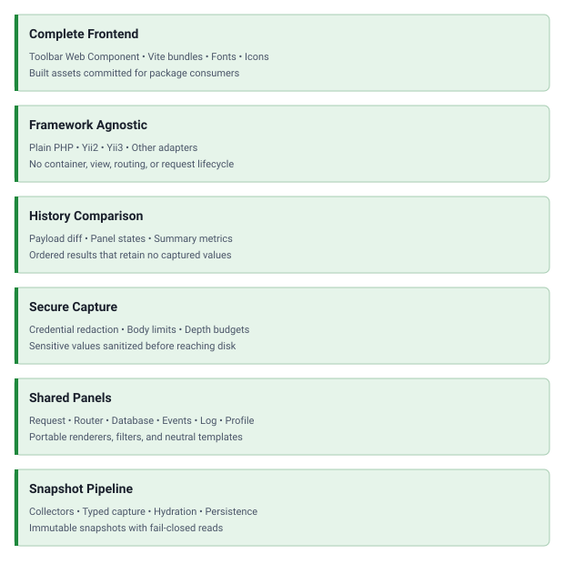

<!-- markdownlint-disable MD041 -->
<p align="center">
    <a href="https://github.com/php-forge/debug-core" target="_blank">
      
    </a>
    <h1 align="center">Debug Core</h1>
    <br>
</p>
<!-- markdownlint-enable MD041 -->

<p align="center">
    <a href="https://github.com/php-forge/debug-core/actions/workflows/build.yml" target="_blank">
        
    </a>
    <a href="https://codecov.io/github/php-forge/debug-core" target="_blank">
        
    </a>
    <a href="https://dashboard.stryker-mutator.io/reports/github.com/php-forge/debug-core/main" target="_blank">
        
    </a>
    <a href="https://github.com/php-forge/debug-core/actions/workflows/static.yml" target="_blank">
        
    </a>
</p>

<p align="center">
    <strong>A framework-agnostic PHP core providing snapshots, storage, and the complete frontend for debugger adapters.</strong>
</p>

## Features

<picture>
    <source media="(min-width: 768px)" srcset="https://raw.githubusercontent.com/php-forge/debug-core/main/docs/svgs/features.svg">
    
</picture>

## Installation

Install an adapter, not this package. Debug Core is pulled in transitively:

- [`yii2-extensions/debug`](https://github.com/yii2-extensions/debug)
- [`yii3/debug`](https://github.com/yii3/debug)

If you develop an adapter:

```bash
composer require php-forge/debug-core:^0.1
```

PHP 8.3 or later and the `ctype`, `intl`, and `mbstring` extensions are required.

## Adapter boundary

The core owns snapshot capture, persistence, comparison, and the shared UI. A framework adapter remains responsible
for:

- collecting framework data through `PHPForge\Debug\CollectorInterface`, the single collector contract shared with
  provider-owned collectors, and returning the persisted payload from `capture()`;
- exposing the toolbar data endpoints and deciding when a response receives the toolbar;
- defining and publishing assets through its own framework;
- rendering the shared templates with its view component;
- routes, controllers, URL generation, panel metadata, and framework-specific panel views;
- implementing `Routing\DebugUrlGeneratorInterface` so portable renderers build panel links without a framework URL
  manager.

The adapter-facing API is documented in the source PHPDoc under `src/`.

## Frontend development

The frontend source lives in `resources/src` and Vite builds it into `resources/assets/dist`. Two entries are built:

- `resources/src/toolbar/index.js` — the `<yii-debug-toolbar>` custom element. `element.js` owns the view state, the
  shadow skeleton, and the render cycle; it composes one controller per responsibility (`loader.js`,
  `theme-controller.js`, `drawer.js`) and renders through the stateless builders in `render.js`.
- `resources/src/core/debug.js` — the debugger page bootstrap. It resolves the theme, initializes the page
  controllers (`theme.js`, `disclosure.js`, `live-filter.js`, `grid-navigation.js`, `tabs.js`, `deep-links.js`,
  `clipboard.js`, `features.js`), and owns the keyboard precedence between the layers.

Rebuild and verify with:

```bash
npm install
npm run format:check
npm run lint:js
npm run lint:css
npm run test:js
npm run build
npm run check:size
npm run check:icons
```

`check:icons` compares the toolbar's inline glyphs with `resources/assets/svg`; the toolbar-only chrome glyphs
(`chevron-left`, `chevron-right`, `close`, `external-link`) have no panel file by design and never fail `--strict`.

## Documentation

This package has no separate guides; its documentation topics live in this README and the source PHPDoc.

- 📦 [Installation](#installation)
- 🧩 [Adapter boundary](#adapter-boundary)
- 🎨 [Frontend development](#frontend-development)

## AI assistance

AI agents: read the [documentation index](https://yii2-framework.github.io/docs/llms.txt) and fetch the Markdown version
of a page by appending `index.md` to its URL. The
[AI agents guide](https://github.com/yii2-framework/docs/blob/main/src/content/docs/project/ai-agents.md) covers skill
installation, client setup and verification.

- 🤖 [`php-forge-debug-core` skill](https://github.com/php-forge/debug-core/blob/main/docs/agents.md): building a
  debugger adapter on the core, with snapshot storage and read diagnostics, log context redaction, the routing
  contract and the toolbar frontend sources.

See the [repository guides](#documentation), the [skill source](skills/php-forge-debug-core/SKILL.md), the source PHPDoc
and the [changelog](CHANGELOG.md).

## Package information

[](https://www.php.net/releases/8.3/en.php)
[](https://github.com/php-forge/debug-core/actions/workflows/static.yml)
[](https://packagist.org/packages/php-forge/debug-core)
[](https://packagist.org/packages/php-forge/debug-core)

## Code quality

[](https://github.com/php-forge/debug-core/actions/workflows/quality.yml)
[](https://github.com/php-forge/debug-core/actions/workflows/assets.yml)
[](https://github.styleci.io/repos/1334500828?branch=main)

## Security

[](https://scorecard.dev/viewer/?uri=github.com/php-forge/debug-core)
[](https://github.com/php-forge/debug-core/actions/workflows/security.yml)

## Built with AI

[](https://claude.com/claude-code)
[](https://openai.com/codex)
[](https://www.coderabbit.ai)

## Social networks

[](https://x.com/Terabytesoftw)

## License

[](LICENSE)
